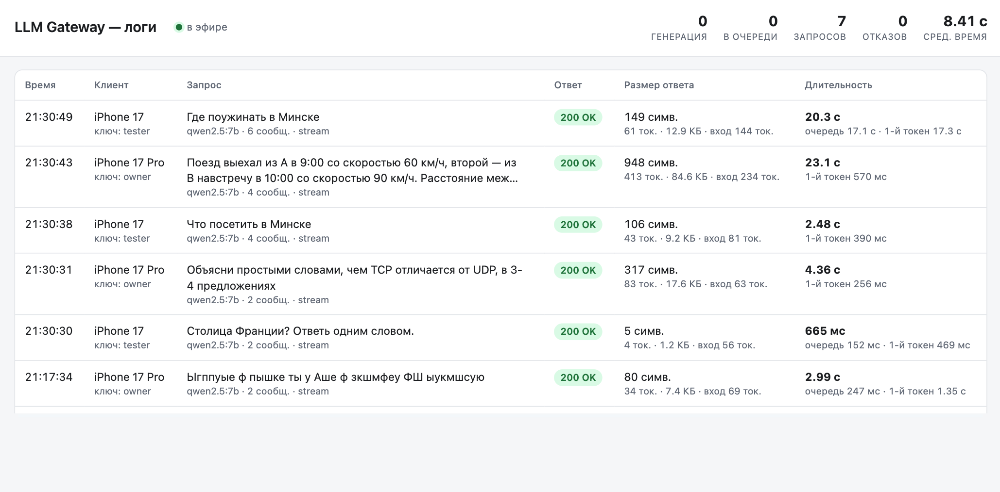

# Day 30 — local LLM as a private service

**Server:** this Mac (Apple M1 Pro, 32 GB), Ollama 0.35.1 with `qwen2.5:7b`
and `gemma3:12b`. **Service:** `llm-gateway/` on `0.0.0.0:8088`, details in
[llm-gateway/README.md](../llm-gateway/README.md).

## Why Ollama alone isn't enough

| Need | Ollama as is | Gateway |
|---|---|---|
| Reachable over the network | listens on `127.0.0.1:11434` | `0.0.0.0:8088`, Ollama stays local |
| Private | no authentication | Bearer key per client |
| Rate limit | none | N requests/min per client → 429 |
| Load | queues without limit | 1 at a time + queue of 8 → 503 |
| Max context | cuts the start of a long prompt **silently** (checked: a 1,950-token prompt at `num_ctx` 512 went through as 258 tokens) | 400 with the exact size, via `truncate: false` |
| Chat API | native + `/v1` | OpenAI-compatible `/v1/chat/completions`, plain and streaming |

## Checks

All requests went to the LAN address `http://192.168.1.139:8088`, not to
localhost. The macOS firewall is off, so the port is open to the local network.

| # | Check | Result |
|---|---|---|
| 1 | `GET /health` over the network | 200, Ollama ok, limits listed |
| 2 | No key / wrong key | 401 `invalid_api_key` |
| | `GET /v1/models` | `gemma3:12b`, `qwen2.5:7b` (only `ALLOWED_MODELS`) |
| | Unknown model | 404 `model_not_found` |
| 3 | Chat, two turns: "Меня зовут Майк. Запомни." → "Как меня зовут?" | "Тебя зовут Майк." First answer 5.0 s (model loading with num_ctx 8192), second 0.7 s |
| 4 | `stream: true` + `include_usage` | `text/event-stream`, 17 chunks, final usage chunk, `[DONE]` |
| 5 | ~14k-token message | 400 `context_length_exceeded`: "14430 tokens, but the context window is 8192"; answered at once, before generation |
| 6 | `max_tokens: 20` | `finish_reason: "length"`, 20 completion tokens |
| | `max_tokens: 999999` | accepted, capped at 1024 |
| 7 | 6 requests at once, two clients | all 200, all 6 answers correct (`n+n`), 1.5 s wall time, served one after another through the queue |
| 8 | 12 requests at once (1 active + queue 8) | 9 × 200, 3 × 503 `server_busy` with `Retry-After: 10` |
| 9 | 25 quick requests from one client (limit 20/min) | 429 once the minute's budget ran out, `Retry-After: 42`; the other client was unaffected |
| 10 | Client hangs up mid-stream (asked for 800 words) | generation stopped (`client_closed` in the log); the next request was answered in 0.4 s, load back to 0/0 |

## Notes

- **Context check:** Ollama has no tokenize endpoint, and estimating from
  characters is too rough (qwen2.5 averages 4.8 characters per token in
  English, 3.1 in Russian and 2.0 in code). The gateway lets Ollama count
  instead: native `/api/chat` with `truncate: false` returns an error with
  `n_prompt_tokens`, which the gateway turns into a 400. This is why the
  gateway uses `/api/chat` and translates to the OpenAI format, rather than
  proxying Ollama's own `/v1`.
- **Fixed `num_ctx`:** each change of `num_ctx` reloads the model, so every
  request uses the same value.
- **Queue in the gateway, not in Ollama:** a full queue gets a quick 503, and
  a client that leaves gives up its place instead of keeping a generation
  running.
- **Limits of this setup:** the service works only on the local network,
  over plain HTTP, and only while the Mac is awake. Reaching it from outside
  needs Tailscale or TLS plus port forwarding.

## Demo: live log and iOS clients

In the screenshot, iPhone 17's "Где поужинать в Минске" (21:30:49) waited
17.1 s in the queue behind iPhone 17 Pro's train problem, which took 23.1 s
and 413 tokens. With one generation at a time, the requests ran in turn.

- `http://localhost:8088/logs` is a live table of requests: what was asked,
  the outcome, the response size (characters, tokens, bytes) and timings
  (total, time in queue, time to first token).
- `ios/LLMChat` is a SwiftUI chat app. Run it in two simulators at once with
  different keys (`owner` on iPhone 17 Pro, `tester` on iPhone 17), both
  pointed at the LAN address `192.168.1.139:8088`. Two questions sent at the
  same time: iPhone 17 Pro was answered in 2.99 s; iPhone 17 waited 2.99 s in
  the queue and was answered after 4.93 s in total. On the log page, the
  second request stays "в очереди" until the first one finishes.
